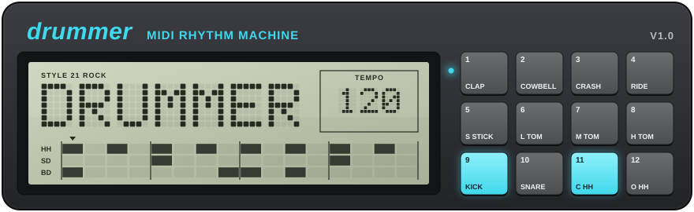

<p align="center"></p>

# Drummer

A little command-line drum machine for Windows, inspired by the Boss Dr. Rhythm DR-550.
It plays 23 classic rhythm styles through any MIDI output device, with variations,
breaks, endings and swing, and can record what it plays to a MIDI file.

The patterns have been lifted from "260 Drum Machine Patterns" by Rene-Pierre Bardet (1987). Unlike other drum players on GitHub that use these patterns, this one includes flams.

## Building

Works with [WinLibs](https://winlibs.com/) MinGW:

```bash
gcc main.c -o drummer -lwinmm
```

To regenerate `patterns.h` after editing `tools/drum_patterns.all.txt`, see the steps at
the top of `tools/build_pattern_tbl.py`.

## Usage

```bash
drummer [options] [style] [bpm]
```

`style` is a number (0-22) or a name ("rock", "cha cha", "r&b", ...).
`bpm` defaults to 120 and is clamped to 60-300.

| Option    | Description                                             |
| --------- | ------------------------------------------------------- |
| `-l`      | list the MIDI output devices                            |
| `-d N`    | play on MIDI output device N (default 0)                |
| `-o FILE` | also record what's played to a MIDI file, saved on exit |
| `-s N`    | swing in percent, 50 (straight) to 75 (default 50)      |

For example, a swung shuffle at 96 bpm, recorded to a file:

```bash
drummer -s 60 -o groove.mid shuffle 96
```

### Styles

| #   | Style      | #   | Style      | #   | Style  |
| --- | ---------- | --- | ---------- | --- | ------ |
| 0   | tango      | 8   | boogie     | 16  | disco  |
| 1   | charleston | 9   | blues      | 17  | funk   |
| 2   | paso       | 10  | swing      | 18  | pop    |
| 3   | waltz      | 11  | shuffle    | 19  | r&b    |
| 4   | twist      | 12  | samba      | 20  | reggae |
| 5   | ska        | 13  | jazz       | 21  | rock   |
| 6   | march      | 14  | bossa      | 22  | slow   |
| 7   | cha cha    | 15  | afro cuban |     |        |

### Keys while playing

| Key              | Action                                                     |
| ---------------- | ---------------------------------------------------------- |
| left / right     | previous / next variation (switches at the end of the bar) |
| up / down        | next / previous style (switches at the end of the bar)     |
| `-` / `+`        | tempo down / up                                            |
| `[` / `]`        | swing down / up                                            |
| `b` or space     | play a break on the next bar                               |
| `e`              | play an ending, then stop                                  |
| `q`, esc, ctrl+c | quit right away                                            |

## Credits

Written and initial coding by Anthony C. Bartman ([@rommix0](https://github.com/rommix0)), with later help from Claude.
